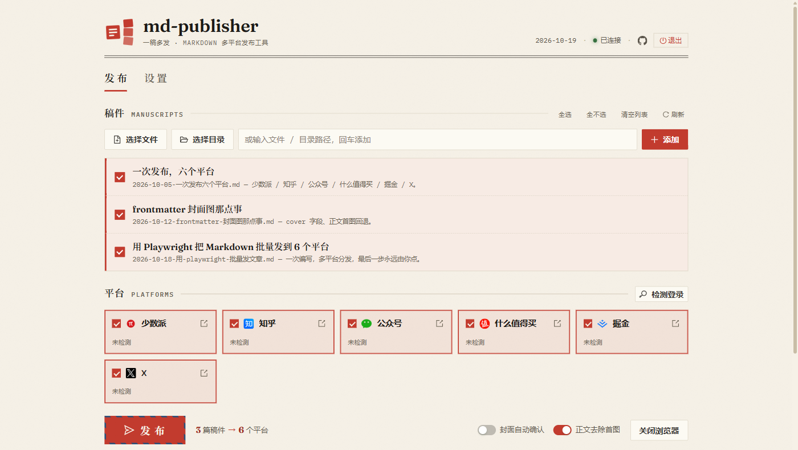

# md-publisher

> Markdown 一稿多发 —— 写一次，自动填充 6 个内容平台，最后一步永远由你点。

[](LICENSE) [](https://github.com/rockbenben/365opensource)

[⬇ 下载桌面应用](https://github.com/rockbenben/md-publisher/releases) · [📖 使用说明](usage.md) · [🐛 提 Issue](https://github.com/rockbenben/md-publisher/issues) · [🛠 从源码运行](#从源码运行)



基于 Playwright 浏览器自动化：工具打开各平台编辑器、自动填写标题与正文，**你只需检查后点击各平台的「发布」**。工具完全跑在本机，不会自己把稿件发到任何地方；文章真正上线，只发生在你于对应平台点下「发布」的那一步。

## 支持范围

| 维度 | 支持情况 |
| --- | --- |
| 操作系统 | Windows / macOS / Linux |
| 浏览器 | 系统已安装的 Chrome / Edge / Brave / Vivaldi / 360 / QQ 等 Chromium 内核浏览器（Windows 自带 Edge） |
| 文章格式 | Markdown（`.md` `.markdown` `.mdown` `.mkd` `.mkdn` `.mdwn` `.mdx` `.txt`） |
| 发布平台 | 少数派、知乎、微信公众号、什么值得买、掘金、X (Twitter) |

扫描目录时会自动跳过 `README.md`、`CHANGELOG.md`、`LICENSE.*`，以及 `node_modules/`、隐藏目录和 `user-data/`。

### 各平台自动做到哪一步

| 平台 | 标识 | 自动操作 | 封面 |
| --- | --- | --- | --- |
| 少数派 | `sspai` | 填写标题 → 粘贴 Markdown → 触发格式转换 → 设置封面 | ✓ |
| 知乎 | `zhihu` | 填写标题 → 粘贴 Markdown → 自动解析 → 设置封面 | ✓ |
| 微信公众号 | `wechat` | Markdown 转富文本 → 填写标题/摘要 → 粘贴内容 → 上传设置封面 | ✓ |
| 什么值得买 | `smzdm` | 填写标题 → Markdown 转 HTML 后粘贴 → 上传长图封面 | ✓ |
| 掘金 | `juejin` | 填写标题 → 粘贴 Markdown 原文 → 发布抽屉内上传封面 | ✓ |
| X (Twitter) | `x` | 填写标题 → 粘贴富文本 → 上传图片/代码块 → 设置封面 | ✓ |

工具填完会保持页面打开，由你检查内容并手动点击该平台的「发布」。需要更多平台请到 [Issues](https://github.com/rockbenben/md-publisher/issues) 提。

## 能做什么

- **多篇 × 多平台** —— 一次勾选多篇文章和多个平台，批量自动填充
- **内容按平台适配** —— 原文粘贴、转富文本还是转 HTML，由各平台的编辑器决定
- **提示语法转换** —— GitHub 风格的 `> [!NOTE]` 等提示框自动转成 emoji 标签
- **发布可取消** —— GUI 中发布过程可随时中断，已填好的平台不受影响

## 快速开始

1. 从 [Releases](https://github.com/rockbenben/md-publisher/releases) 下载对应平台的安装包并安装（macOS 未签名，首次打开请右键 →「打开」）。
2. 启动后首次使用会打开浏览器，逐个平台登录一次。登录态存在本机，之后自动复用。
3. 在「稿件」里勾选文章，在「平台」里勾选目标，点「发布」。工具逐个平台打开编辑器并填好内容，你检查后各点一次「发布」。

应用常驻系统托盘，关窗口只是最小化；从托盘菜单可重新加载界面、重启服务、关闭自动化浏览器、打开日志文件或退出。

## 文章格式

在 Markdown 文件开头用 YAML frontmatter 声明元数据。全部字段都是可选的：

| 字段 | 说明 |
| --- | --- |
| `title` | 文章标题。省略时取正文第一个一级标题（`# 标题`），都没有则用文件名 |
| `description` | 文章摘要，公众号会自动填入摘要栏 |
| `date` | 发布日期 |
| `cover` | 封面图，支持网络 URL 或相对文章文件的本地路径 |
| `category` | 分类，字符串或数组 |
| `tag` | 标签，字符串或数组 |

```markdown
---
title: 我的文章标题
description: 文章摘要（可选）
date: 2026-06-18
cover: https://example.com/cover.png
category:
  - 技术
tag:
  - Markdown
---

正文从这里开始。

> [!NOTE]
> GitHub 风格的提示语法会自动转换为 emoji 标签。


```

**封面从哪来：** frontmatter 的 `cover` 优先，否则自动取正文第一张图（webp / gif 会转成 JPEG，超过 5MB 会压缩）。

**正文里的图会被移走吗：** 开启「正文去除首图」且未设 `cover` 时，被用作封面的那张图会从正文移除以免重复；一旦显式设置了 `cover`，正文图片原样保留。

代码块里的图片、标题和提示语法都会被识别逻辑跳过，文档中的语法示例原样保留。

## 项目配置

在文章目录下放一个 `.md-publisher.yml`，统一预设发布参数：

```yaml
platforms:
  - sspai
  - zhihu
  - juejin
category:
  - 技术
tag:
  - Markdown
```

CLI 和 GUI 都会自动读取并预选其中的平台。`category` / `tag` 仅作为提示输出，不会自动填写——各平台的分类与标签都需要你手动设置。字段详见[使用说明 — 项目配置](usage.md#项目配置)。

## 从源码运行

需要 Node.js（>= 18 运行，>= 22.12 构建桌面应用）与一个 Chromium 内核浏览器。

```bash
git clone https://github.com/rockbenben/md-publisher.git
cd md-publisher
npm install
npm start          # CLI：交互式选择文章与平台
npm run gui        # GUI：浏览器打开 http://127.0.0.1:9870
```

GUI 前端构建产物已随仓库提供，无需额外构建即可 `npm run gui`。从源码打包桌面应用见 [CONTRIBUTING.md](CONTRIBUTING.md)。

<details>
<summary>环境变量</summary>

| 变量 | 说明 | 默认值 |
| --- | --- | --- |
| `PORT` | GUI 服务端口 | `9870` |
| `HOST` | 监听地址 | `127.0.0.1`（仅本机） |
| `NO_OPEN` | 设为 `1` 跳过自动打开浏览器 | — |
| `MDPUB_DATA_DIR` | 设置、登录态与浏览器配置的存放目录 | 仓库根目录 |
| `CHROME_PATH` | 指定用于自动化的浏览器可执行文件 | 自动探测 |
| `CDP_PORT` | 浏览器调试端口 | `9322` |

服务只监听本机回环地址，并拒绝非本机 `Origin` 的 API 请求——该接口没有鉴权，能读取文件、发布文章并关闭应用。确有跨机器访问需要时设 `HOST=0.0.0.0`，请仅在可信网络中使用。

</details>

## 已知限制

- **平台改版会让自动化失效。** 各平台的选择器依赖其页面结构，改版后可能"报成功但没填进去"。遇到这种情况请提 Issue。
- **macOS 安装包未签名**，首次打开需要右键 →「打开」，或在「系统设置 → 隐私与安全性」中放行。
- **封面裁剪确认在 CLI 里无法关闭。** 该开关只存在于 GUI；命令行一律自动确认裁剪。
- **分类与标签不会被自动填写。** 配置与 frontmatter 里的值只作提示，各平台需手动选择。
- **首次使用需要逐个平台登录一次**，工具不会替你保管账号密码。
- **桌面应用会向 GitHub 发一次匿名请求检查新版本**，托盘菜单里也有「检查更新」。不发送任何稿件、路径或账号信息；检查失败时不会打扰你。工具永远不会自行更新——发现新版只通知，是否升级由你决定。

## 关于 365 开源计划

[365 开源计划](https://github.com/rockbenben/365opensource) 的第 **#043** 个项目——一个人 + AI，一年 300+ 个开源项目。

[提交你的需求 →](https://365.aishort.top/) · [Discord](https://discord.gg/PZTQfJ4GjX) · [Telegram](https://t.me/aishort_top)
